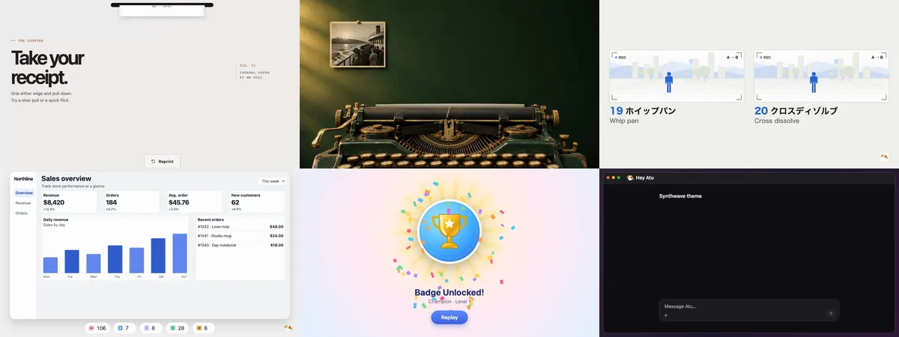
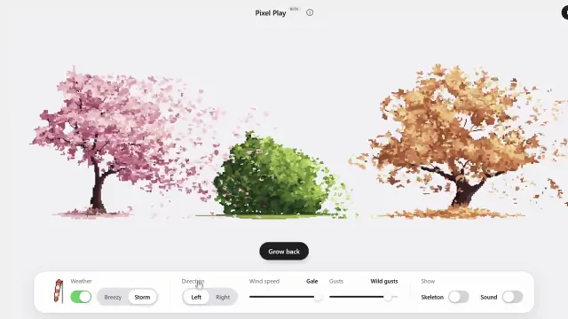
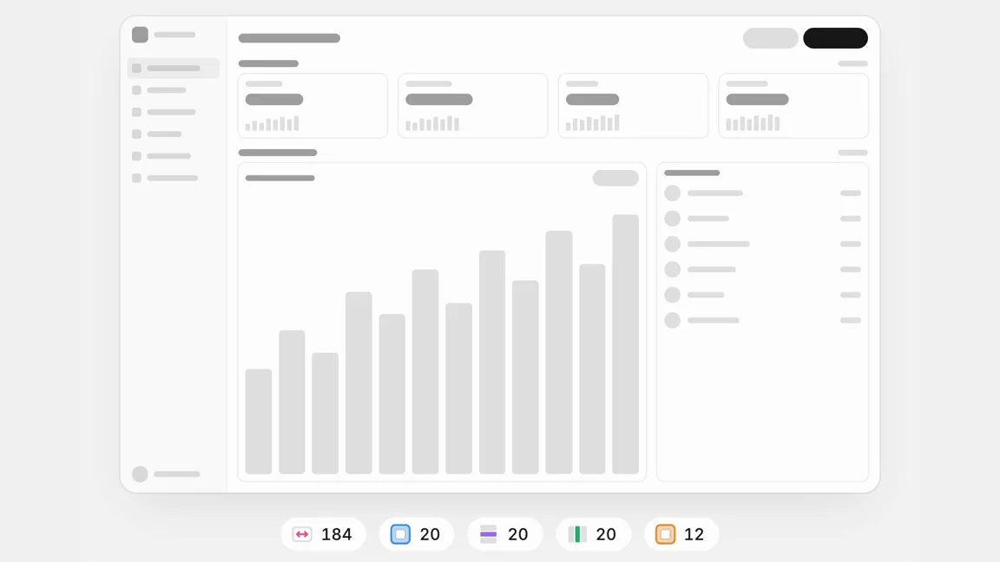
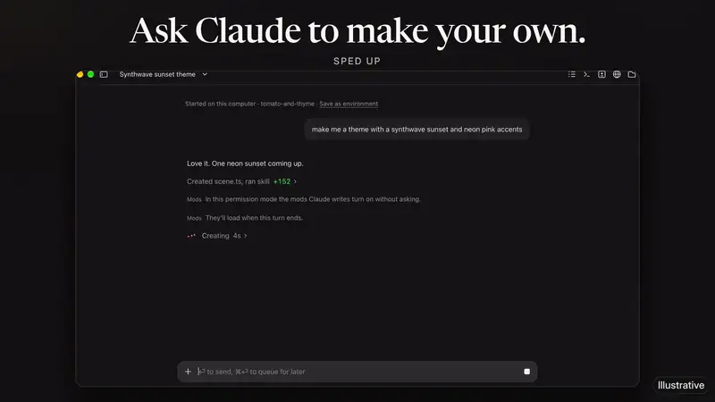

# Awesome Agent Showcase

Ideas from public posts that you can build with an agent on your own computer.

[](https://heyatu.com/market?utm_source=github&utm_medium=readme&utm_campaign=market-hero)

[Browse on Hey Atu Market](https://heyatu.com/market?utm_source=github&utm_medium=readme&utm_campaign=market-hero) · [Download Hey Atu for Mac](https://heyatu.com/download) · [Suggest a post](https://github.com/heyatu/awesome-agent-showcase/issues/new?template=suggest-a-post.yml)

Each item has a short brief. Copy the brief into your own agent, or open the tested version in Hey Atu with one press.

## Collection

<!-- collection:start -->
<!-- Generated by scripts/readme.mjs. Edit entries or tags, then run it again. -->

### Animation and video (3)

<table>
<tr>
<td width="50%" valign="top">

<a href="https://heyatu.com/market/x-2103473953868063151?utm_source=github&amp;utm_medium=readme&amp;utm_campaign=market-grid"><picture><source media="(prefers-reduced-motion: reduce)" srcset="entries/x-2103473953868063151/media/badge-still.webp"></picture></a>

<p><strong><a href="https://heyatu.com/market/x-2103473953868063151?utm_source=github&amp;utm_medium=readme&amp;utm_campaign=market-grid">A badge unlock animation</a></strong><br>A trophy badge pops in, bursts with light rays and confetti, and settles with a glow, all on a web page.</p>

<p>via <a href="https://x.com/adriankuleszo/status/2103473953868063151">@adriankuleszo</a> · Tested in Hey Atu</p>

<details>
<summary>Brief</summary>

```text
A web page with a badge-unlock moment: a gold trophy on a bright badge pops in, light rays and confetti burst out, then everything settles into a soft glow. A Replay button restarts the whole animation every time, even when pressed twice in a row. Draw all of it in code, with no image files.
```

</details>

<p><a href="https://heyatu.com/market/x-2103473953868063151?utm_source=github&amp;utm_medium=readme&amp;utm_campaign=market-category">Run the tested version in Hey Atu →</a></p>

</td>
<td width="50%" valign="top">

<a href="https://heyatu.com/market/x-2109112248832503895?utm_source=github&amp;utm_medium=readme&amp;utm_campaign=market-grid"><picture><source media="(prefers-reduced-motion: reduce)" srcset="entries/x-2109112248832503895/media/whip-pan-still.webp"></picture></a>

<p><strong><a href="https://heyatu.com/market/x-2109112248832503895?utm_source=github&amp;utm_medium=readme&amp;utm_campaign=market-grid">Name your camera moves</a></strong><br>Swap “make it look nice” for a named camera move, and give AI a shot to aim for.</p>

<p>via <a href="https://x.com/showheyohtaki/status/2109112248832503895">@showheyohtaki</a> · Tested in Hey Atu</p>

<details>
<summary>Brief</summary>

```text
A ten-second product promo that plays in the browser, built from three named camera moves: a dolly in that closes on the product, a rack focus that shifts what is sharp, and a whip pan that swings fast, with blur, into the end card. Use my product or invent a sample one, and give each move its own clear moment.
```

</details>

<p><a href="https://heyatu.com/market/x-2109112248832503895?utm_source=github&amp;utm_medium=readme&amp;utm_campaign=market-category">Run the tested version in Hey Atu →</a></p>

</td>
</tr>
<tr>
<td width="50%" valign="top">

<a href="https://heyatu.com/market/x-2119458988165370270?utm_source=github&amp;utm_medium=readme&amp;utm_campaign=market-grid"><picture><source media="(prefers-reduced-motion: reduce)" srcset="entries/x-2119458988165370270/media/wind-cover-still.webp"></picture></a>

<p><strong><a href="https://heyatu.com/market/x-2119458988165370270?utm_source=github&amp;utm_medium=readme&amp;utm_campaign=market-grid">Pixel Play Wind Garden</a></strong><br>Bend the wind and send pixel leaves tumbling.</p>

<p>via <a href="https://x.com/SolutionB2u/status/2119458988165370270">@SolutionB2u</a> · Tested in Hey Atu</p>

<details>
<summary>Brief</summary>

```text
An original pixel garden in the browser where the wind moves the leaves. Draw a few trees and shrubs of your own in chunky pixels and let a breeze bend them. Let me reverse the wind or drag a plant to shake its leaves loose, so they tumble and pile up on the ground, then add a button that grows them back.
```

</details>

<p><a href="https://heyatu.com/market/x-2119458988165370270?utm_source=github&amp;utm_medium=readme&amp;utm_campaign=market-category">Run the tested version in Hey Atu →</a></p>

</td>
<td width="50%" valign="top">

</td>
</tr>
</table>

### Coding (4)

<table>
<tr>
<td width="50%" valign="top">

<a href="https://heyatu.com/market/x-2089289550958903358?utm_source=github&amp;utm_medium=readme&amp;utm_campaign=market-grid"><picture><source media="(prefers-reduced-motion: reduce)" srcset="entries/x-2089289550958903358/media/receipt-still.webp"></picture></a>

<p><strong><a href="https://heyatu.com/market/x-2089289550958903358?utm_source=github&amp;utm_medium=readme&amp;utm_campaign=market-grid">A receipt you tear off</a></strong><br>Pull the paper and watch the tear travel across: slow and clean, or quick and rough.</p>

<p>via <a href="https://x.com/marmobs/status/2089289550958903358">@marmobs</a> · Tested in Hey Atu</p>

<details>
<summary>Brief</summary>

```text
A web page where a printed shop receipt feeds out of a slot and you tear it off by dragging the paper. The tear starts at the corner nearest your grip and runs across: a slow pull cuts almost straight with fine serrations, a quick pull rips unevenly and leaves paper fibres. The torn piece curls and falls, and a Reprint button feeds the next receipt.
```

</details>

<p><a href="https://heyatu.com/market/x-2089289550958903358?utm_source=github&amp;utm_medium=readme&amp;utm_campaign=market-category">Run the tested version in Hey Atu →</a></p>

</td>
<td width="50%" valign="top">

<a href="https://heyatu.com/market/x-2103770889116627075?utm_source=github&amp;utm_medium=readme&amp;utm_campaign=market-grid"><picture><source media="(prefers-reduced-motion: reduce)" srcset="entries/x-2103770889116627075/media/dog-still.webp"></picture></a>

<p><strong><a href="https://heyatu.com/market/x-2103770889116627075?utm_source=github&amp;utm_medium=readme&amp;utm_campaign=market-grid">A character that follows your cursor</a></strong><br>Move the mouse and a cute character on a web page turns its eyes and head to follow it.</p>

<p>via <a href="https://x.com/himanshubuildss/status/2103770889116627075">@himanshubuildss</a> · Tested in Hey Atu · Claude Code</p>

<details>
<summary>Brief</summary>

```text
A web page with a friendly cartoon character in the middle of the screen. Its eyes follow the mouse pointer and its head turns a little towards it as the pointer moves. Keep the character simple and flat, draw it in code, and ease the turns so the motion feels alive instead of snapping.
```

</details>

<p><a href="https://heyatu.com/market/x-2103770889116627075?utm_source=github&amp;utm_medium=readme&amp;utm_campaign=market-category">Run the tested version in Hey Atu →</a></p>

</td>
</tr>
<tr>
<td width="50%" valign="top">

<a href="https://heyatu.com/market/x-2111383736243859714?utm_source=github&amp;utm_medium=readme&amp;utm_campaign=market-grid"><picture><source media="(prefers-reduced-motion: reduce)" srcset="entries/x-2111383736243859714/media/cover-still.webp"></picture></a>

<p><strong><a href="https://heyatu.com/market/x-2111383736243859714?utm_source=github&amp;utm_medium=readme&amp;utm_campaign=market-grid">Fix the spacing in your app</a></strong><br>Make a cramped dashboard easier to scan without changing what it does.</p>

<p>via <a href="https://x.com/MichaelFilipiuk/status/2111383736243859714">@MichaelFilipiuk</a> · Tested in Hey Atu</p>

<details>
<summary>Brief</summary>

```text
Fix the spacing of an existing app and change nothing else. Set the sidebar width, add room above the content, tighten or loosen the gaps between cards and give each card comfortable inner padding, so a cramped screen is easy to scan. Every feature and every word of content stays as it is.
```

</details>

<p><a href="https://heyatu.com/market/x-2111383736243859714?utm_source=github&amp;utm_medium=readme&amp;utm_campaign=market-category">Run the tested version in Hey Atu →</a></p>

</td>
<td width="50%" valign="top">

<a href="https://heyatu.com/market/x-2122013352755126431?utm_source=github&amp;utm_medium=readme&amp;utm_campaign=market-grid"><picture><source media="(prefers-reduced-motion: reduce)" srcset="entries/x-2122013352755126431/media/whale-cove-still.webp"></picture></a>

<p><strong><a href="https://heyatu.com/market/x-2122013352755126431?utm_source=github&amp;utm_medium=readme&amp;utm_campaign=market-grid">A calm storybook game with a hand-painted feel</a></strong><br>A kid, a dog and a long way home: a gentle game that you play in your browser.</p>

<p>via <a href="https://x.com/Rubzem/status/2122013352755126431">@Rubzem</a> · Tested in Hey Atu · Fable 5.2</p>

<details>
<summary>Brief</summary>

```text
A small calm game that you play in the browser, told through a few painted scenes of a kid and a dog on a long walk home. There are no timers and no way to lose: you click through each scene and things respond gently. Paint the scenes and make the sounds in code, with a soft hand-painted look.
```

</details>

<p><a href="https://heyatu.com/market/x-2122013352755126431?utm_source=github&amp;utm_medium=readme&amp;utm_campaign=market-category">Run the tested version in Hey Atu →</a></p>

</td>
</tr>
</table>

### Personal workflows (1)

<table>
<tr>
<td width="50%" valign="top">

<a href="https://heyatu.com/market/x-2097383854923538770?utm_source=github&amp;utm_medium=readme&amp;utm_campaign=market-grid"><picture><source media="(prefers-reduced-motion: reduce)" srcset="entries/x-2097383854923538770/media/press-still.webp"></picture></a>

<p><strong><a href="https://heyatu.com/market/x-2097383854923538770?utm_source=github&amp;utm_medium=readme&amp;utm_campaign=market-grid">My Morning Paper</a></strong><br>Read the day ahead like a newspaper, not a feed.</p>

<p>via <a href="https://x.com/karenxcheng/status/2097383854923538770">@karenxcheng</a> · Tested in Hey Atu</p>

<details>
<summary>Brief</summary>

```text
My day as a newspaper, on one web page that prints on a single A4 sheet. A dated serif masthead sits over columns for the weather, my meetings, messages that need a reply, my to-dos and one headline, and the text types in like a typewriter. Fill it from my calendar and messages, and ask me for anything you cannot read.
```

</details>

<p><a href="https://heyatu.com/market/x-2097383854923538770?utm_source=github&amp;utm_medium=readme&amp;utm_campaign=market-category">Run the tested version in Hey Atu →</a></p>

</td>
<td width="50%" valign="top">

</td>
</tr>
</table>

### Agent setup (1)

<table>
<tr>
<td width="50%" valign="top">

<a href="https://heyatu.com/market/x-2121392666244186327?utm_source=github&amp;utm_medium=readme&amp;utm_campaign=market-grid"><picture><source media="(prefers-reduced-motion: reduce)" srcset="entries/x-2121392666244186327/media/synthwave-still.webp"></picture></a>

<p><strong><a href="https://heyatu.com/market/x-2121392666244186327?utm_source=github&amp;utm_medium=readme&amp;utm_campaign=market-grid">Custom themes for Claude Code Desktop</a></strong><br>Describe the look. Claude Code Desktop builds the theme, backdrop and all.</p>

<p>via <a href="https://x.com/ClaudeDevs/status/2121392666244186327">@ClaudeDevs</a> · Claude Code</p>

<details>
<summary>Brief</summary>

```text
A Claude Code Desktop theme in a synthwave style: a striped sunset with a glowing grid as the animated backdrop, neon pink accents on the controls, and dark frosted glass behind the chat so the text stays easy to read. Build it as a mod that follows the official Claude Code mods documentation.
```

</details>

<p><a href="https://heyatu.com/market/x-2121392666244186327?utm_source=github&amp;utm_medium=readme&amp;utm_campaign=market-category">Try it in Hey Atu →</a></p>

</td>
<td width="50%" valign="top">

</td>
</tr>
</table>

<!-- collection:end -->

## Suggest a post

Did you see a public post that you would like to build? [Suggest it](https://github.com/heyatu/awesome-agent-showcase/issues/new?template=suggest-a-post.yml): give the link and what you would make with it. A maintainer reviews every suggestion. A suggestion does not publish anything.

Star this repository to see new items.

## Sources and rights

Each item credits and links its source. Quoted excerpts remain the author’s work. See [third-party rights](THIRD-PARTY.md) to request removal or [contributing](CONTRIBUTING.md) to suggest a correction.

Our code uses the [MIT licence](LICENSE). Our original text and assets, including the briefs and the image at the top, use [CC BY 4.0](LICENSE-CONTENT). Neither licence covers third-party work.

## Repository

The [entry contract](docs/entry-contract.md) defines an item and its release record. [Purpose tags](tags/purposes.json) group items in the collection.

Use Node.js 24 or later. Run `node scripts/validate.mjs` to check the collection and `node scripts/readme.mjs` to rebuild the list.
