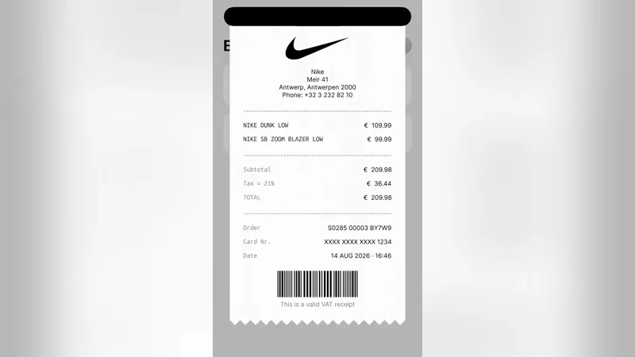
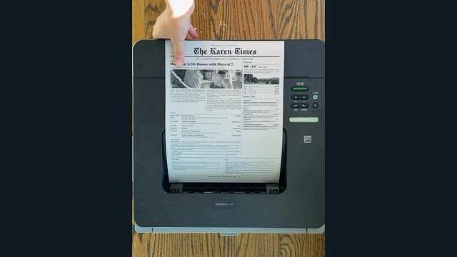
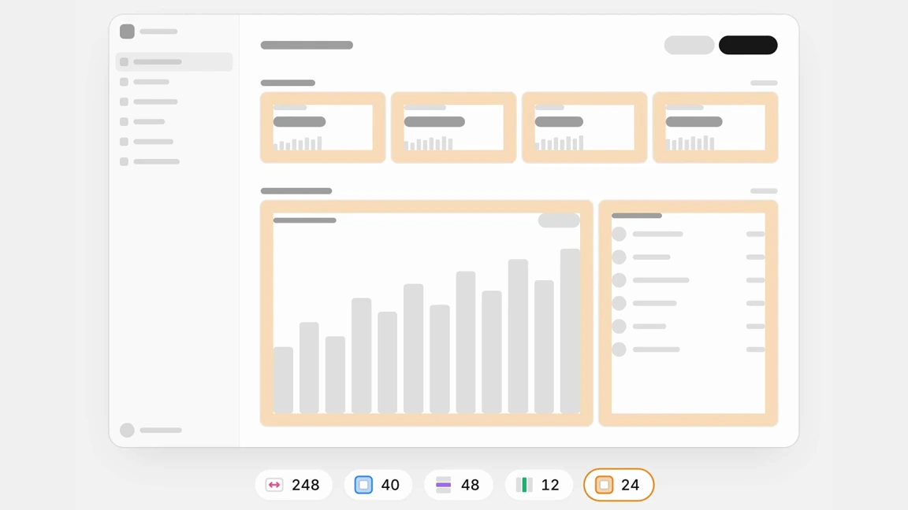
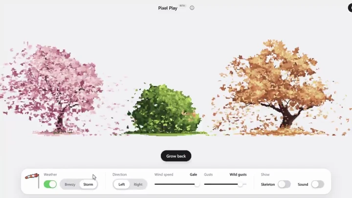

# Awesome Agent Showcase

A collection of public posts with ideas you can try on your Mac with Hey Atu.

[Browse on Hey Atu Market](https://heyatu.com/market?utm_source=github&utm_medium=readme&utm_campaign=market-hero) · [Download Hey Atu for Mac](https://heyatu.com/download)

See the source post, watch the Atu preview where available, then press one button to open the prompt as a draft in Hey Atu.

## Collection

An item can appear under more than one purpose. The total counts each item once.

<!-- collection:start -->
<!-- Generated by scripts/readme.mjs. Edit entries or tags, then run it again. -->

| Purpose | Items |
| --- | ---: |
| Slides | 0 |
| Images | 0 |
| Animation and video | 3 |
| Coding | 5 |
| Research | 0 |
| Personal workflows | 1 |
| Agent setup | 1 |
| **All items (each counted once)** | **9** |

### All items

- [A receipt you tear off](https://heyatu.com/market/x-2089289550958903358?utm_source=github&utm_medium=readme&utm_campaign=market-grid): Pull the paper and watch the tear travel across: slow and clean, or quick and rough.

  

  via [@marmobs](https://x.com/marmobs/status/2089289550958903358)

- [My Morning Paper](https://heyatu.com/market/x-2097383854923538770?utm_source=github&utm_medium=readme&utm_campaign=market-grid): Read the day ahead like a newspaper, not a feed.

  

  via [@karenxcheng](https://x.com/karenxcheng/status/2097383854923538770)

- [A badge unlock animation](https://heyatu.com/market/x-2103473953868063151?utm_source=github&utm_medium=readme&utm_campaign=market-grid): A trophy badge pops in, bursts with light rays and confetti, and settles with a glow, all on a web page.

  

  via [@adriankuleszo](https://x.com/adriankuleszo/status/2103473953868063151)

- [A character that follows your cursor](https://heyatu.com/market/x-2103770889116627075?utm_source=github&utm_medium=readme&utm_campaign=market-grid): Move the mouse and a cute character on a web page turns its eyes and head to follow it.

  

  via [@himanshubuildss](https://x.com/himanshubuildss/status/2103770889116627075)

- [Name your camera moves](https://heyatu.com/market/x-2109112248832503895?utm_source=github&utm_medium=readme&utm_campaign=market-grid): Swap “make it look nice” for a named camera move, and give AI a shot to aim for.

  

  via [@showheyohtaki](https://x.com/showheyohtaki/status/2109112248832503895)

- [Fix the spacing in your app](https://heyatu.com/market/x-2111383736243859714?utm_source=github&utm_medium=readme&utm_campaign=market-grid): Make a cramped dashboard easier to scan without changing what it does.

  

  via [@MichaelFilipiuk](https://x.com/MichaelFilipiuk/status/2111383736243859714)

- [Pixel Play Wind Garden](https://heyatu.com/market/x-2119458988165370270?utm_source=github&utm_medium=readme&utm_campaign=market-grid): Bend the wind and send pixel leaves tumbling.

  

  via [@SolutionB2u](https://x.com/SolutionB2u/status/2119458988165370270)

- [Custom themes for Claude Code Desktop](https://heyatu.com/market/x-2121392666244186327?utm_source=github&utm_medium=readme&utm_campaign=market-grid): Describe the look. Claude Code Desktop builds the theme, backdrop and all.

  

  via [@ClaudeDevs](https://x.com/ClaudeDevs/status/2121392666244186327)

- [A calm storybook game with a hand-painted feel](https://heyatu.com/market/x-2122013352755126431?utm_source=github&utm_medium=readme&utm_campaign=market-grid): A kid, a dog and a long way home: a gentle game that you play in your browser.

  

  via [@Rubzem](https://x.com/Rubzem/status/2122013352755126431)

### Animation and video (3)

- [A badge unlock animation](https://heyatu.com/market/x-2103473953868063151?utm_source=github&utm_medium=readme&utm_campaign=market-category): A trophy badge pops in, bursts with light rays and confetti, and settles with a glow, all on a web page.
- [Name your camera moves](https://heyatu.com/market/x-2109112248832503895?utm_source=github&utm_medium=readme&utm_campaign=market-category): Swap “make it look nice” for a named camera move, and give AI a shot to aim for.
- [Pixel Play Wind Garden](https://heyatu.com/market/x-2119458988165370270?utm_source=github&utm_medium=readme&utm_campaign=market-category): Bend the wind and send pixel leaves tumbling.

### Coding (5)

- [A receipt you tear off](https://heyatu.com/market/x-2089289550958903358?utm_source=github&utm_medium=readme&utm_campaign=market-category): Pull the paper and watch the tear travel across: slow and clean, or quick and rough.
- [A character that follows your cursor](https://heyatu.com/market/x-2103770889116627075?utm_source=github&utm_medium=readme&utm_campaign=market-category): Move the mouse and a cute character on a web page turns its eyes and head to follow it.
- [Fix the spacing in your app](https://heyatu.com/market/x-2111383736243859714?utm_source=github&utm_medium=readme&utm_campaign=market-category): Make a cramped dashboard easier to scan without changing what it does.
- [Pixel Play Wind Garden](https://heyatu.com/market/x-2119458988165370270?utm_source=github&utm_medium=readme&utm_campaign=market-category): Bend the wind and send pixel leaves tumbling.
- [A calm storybook game with a hand-painted feel](https://heyatu.com/market/x-2122013352755126431?utm_source=github&utm_medium=readme&utm_campaign=market-category): A kid, a dog and a long way home: a gentle game that you play in your browser.

### Personal workflows (1)

- [My Morning Paper](https://heyatu.com/market/x-2097383854923538770?utm_source=github&utm_medium=readme&utm_campaign=market-category): Read the day ahead like a newspaper, not a feed.

### Agent setup (1)

- [Custom themes for Claude Code Desktop](https://heyatu.com/market/x-2121392666244186327?utm_source=github&utm_medium=readme&utm_campaign=market-category): Describe the look. Claude Code Desktop builds the theme, backdrop and all.

<!-- collection:end -->

## Sources and rights

Each item credits and links to its source. Quoted excerpts remain the author’s work. See [third-party rights](THIRD-PARTY.md) to request removal or [contributing](CONTRIBUTING.md) to suggest a correction.

Our code uses the [MIT licence](LICENSE). Our original text and assets use [CC BY 4.0](LICENSE-CONTENT). Neither licence covers third-party work.

## Repository

The [entry contract](docs/entry-contract.md) defines an item and its release record. [Purpose tags](tags/purposes.json) group items in the collection.

Use Node.js 24 or later. Run `node scripts/validate.mjs` to check the collection and `node scripts/readme.mjs` to rebuild the list.
