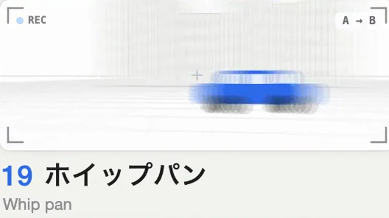
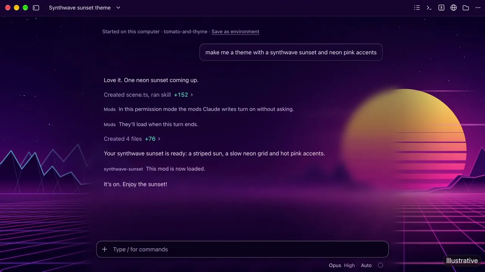

# Awesome Agent Showcase

A curated collection of public posts and tools that show what a personal agent can do for you. Each item will explain one specific outcome, credit its source and say what you need to try it.

**Status: the collection is being prepared.** It has its first items. Nothing here is ready to install or reproduce.

## Why this exists

A personal agent works on your own computer, on your own files and tasks. [Hey Atu](https://heyatu.com) lets you continue that work from your phone. This collection looks at what such an agent can do, by purpose, in plain terms.

## Collection

An item can belong to more than one purpose. Each purpose counts an item once. The total counts every item once.

<!-- collection:start -->
<!-- Generated by scripts/readme.mjs. Edit entries or tags, then run it again. -->

| Purpose | Items |
| --- | ---: |
| Slides | 0 |
| Images | 0 |
| Animation and video | 2 |
| Coding | 3 |
| Research | 0 |
| Personal workflows | 0 |
| Agent setup | 1 |
| **All items (each counted once)** | **6** |

### All items

- A receipt you tear off: Drag the receipt away slowly for a clean tear, or fast for a jagged edge.

  

  via [@marmobs](https://x.com/marmobs/status/2089289550958903358)

- A badge unlock animation: A trophy badge pops in, bursts with light rays and confetti, and settles with a glow, all on a web page.

  

  via [@adriankuleszo](https://x.com/adriankuleszo/status/2103473953868063151)

- A character that follows your cursor: Move the mouse and a cute character on a web page turns its eyes and head to follow it.

  

  via [@himanshubuildss](https://x.com/himanshubuildss/status/2103770889116627075)

- Name your camera moves: Swap “make it look nice” for a named camera move, and give AI a shot to aim for.

  

  via [@showheyohtaki](https://x.com/showheyohtaki/status/2109112248832503895)

- Custom themes for Claude Code Desktop: Describe the look. Claude Code Desktop builds the theme, backdrop and all.

  

  via [@ClaudeDevs](https://x.com/ClaudeDevs/status/2121392666244186327)

- A calm storybook game with a hand-painted feel: A kid, a dog and a long way home: a gentle game that you play in your browser.

  

  via [@Rubzem](https://x.com/Rubzem/status/2122013352755126431)

### Animation and video (2)

- A badge unlock animation: A trophy badge pops in, bursts with light rays and confetti, and settles with a glow, all on a web page.
- Name your camera moves: Swap “make it look nice” for a named camera move, and give AI a shot to aim for.

### Coding (3)

- A receipt you tear off: Drag the receipt away slowly for a clean tear, or fast for a jagged edge.
- A character that follows your cursor: Move the mouse and a cute character on a web page turns its eyes and head to follow it.
- A calm storybook game with a hand-painted feel: A kid, a dog and a long way home: a gentle game that you play in your browser.

### Agent setup (1)

- Custom themes for Claude Code Desktop: Describe the look. Claude Code Desktop builds the theme, backdrop and all.

<!-- collection:end -->

## Sources and rights

- Items link to their original public source. The source author gets credit on each item.
- Third-party media is not stored here unless its rights record allows it. Otherwise an item links to the source. A short excerpt of the media of a source post may be stored and credited ("via @handle"); it stays the author's work, and we remove it on request.
- The code is MIT ([LICENSE](LICENSE)). Our original editorial text and assets are CC BY 4.0 ([LICENSE-CONTENT](LICENSE-CONTENT)). Neither licence covers third-party work.
- See [THIRD-PARTY.md](THIRD-PARTY.md) for credits and rights, and [CONTRIBUTING.md](CONTRIBUTING.md) to suggest a correction.

## Repository

- [docs/entry-contract.md](docs/entry-contract.md) defines an item: its ID, fields, rights, revision and public link.
- `tags/purposes.json` lists the purposes.
- `node scripts/validate.mjs` checks the collection and the public tree. `node scripts/readme.mjs` rebuilds the collection block above. `node --test "test/*.test.mjs"` runs the tests. Node 24 or later; no dependencies.
