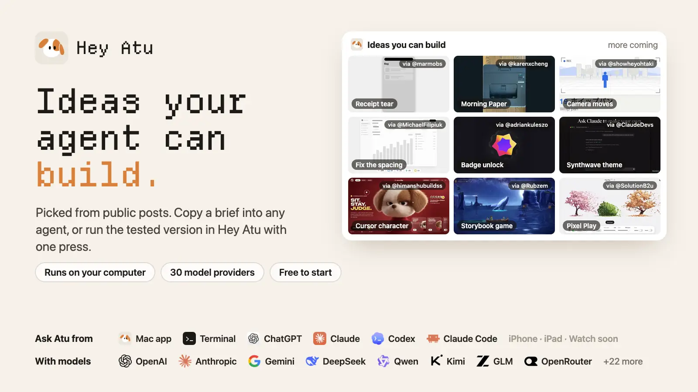
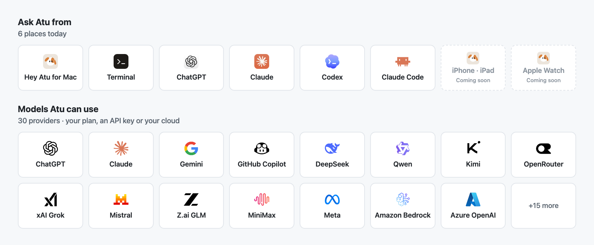
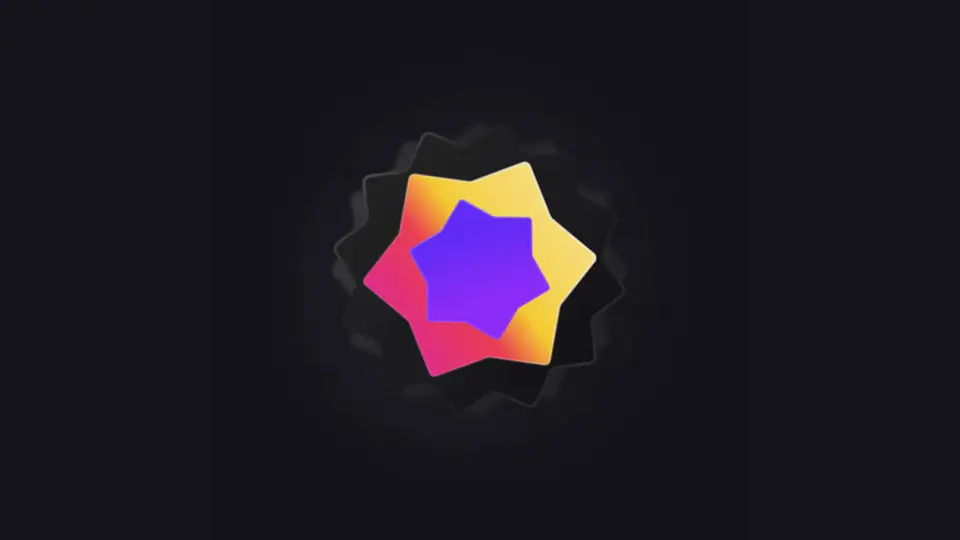
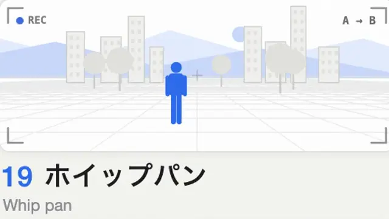
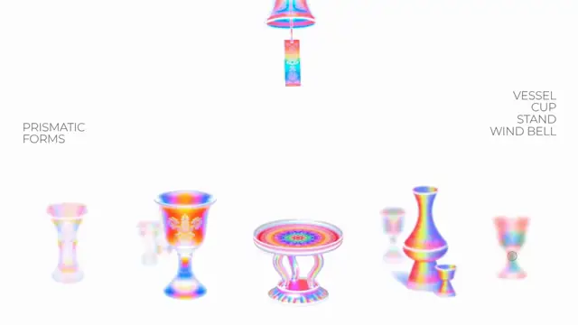
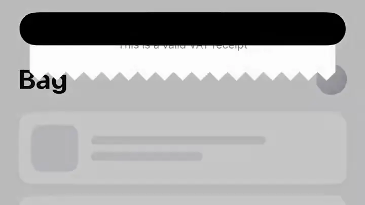
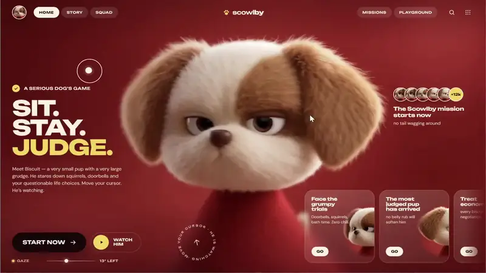
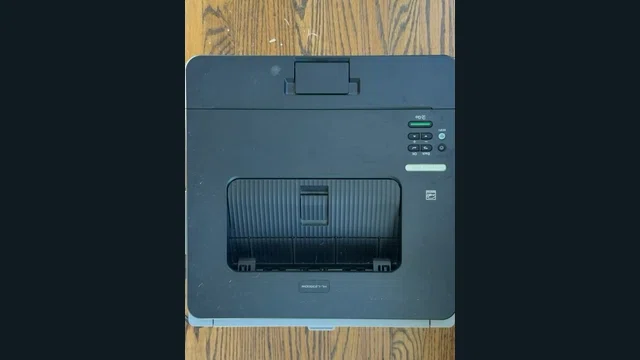

# Awesome Agent Showcase

<a href="https://heyatu.com/market?utm_source=github&amp;utm_medium=readme&amp;utm_campaign=market-hero"><picture><source media="(prefers-reduced-motion: reduce) and (max-width: 600px)" srcset="docs/readme/hero-narrow-still.jpg"><source media="(prefers-reduced-motion: reduce)" srcset="docs/readme/hero-still.jpg"><source media="(max-width: 600px)" srcset="docs/readme/hero-narrow.webp"></picture></a>

<p align="center">
<a href="https://heyatu.com?utm_source=github&amp;utm_medium=readme&amp;utm_campaign=badge-heyatu"></a> <a href="https://heyatu.com/market?utm_source=github&amp;utm_medium=readme&amp;utm_campaign=badge-market"></a> <a href="https://heyatu.com/download/mac?utm_source=github&amp;utm_medium=readme&amp;utm_campaign=badge-download"></a> <a href="https://heyatu.com/pricing?utm_source=github&amp;utm_medium=readme&amp;utm_campaign=badge-free-start"></a> <a href="https://github.com/heyatu/awesome-agent-showcase?utm_source=github&amp;utm_medium=readme&amp;utm_campaign=badge-licence#sources-and-rights"></a>
</p>

<p align="center">
<a href="#your-own-ai-on-your-own-computer">What is Hey Atu</a> · <a href="#install">Install</a> · <a href="#works-with-your-ai">Works with</a> · <a href="#ideas">Ideas</a> · <a href="#suggest-an-idea">Suggest an idea</a>
</p>

## Your own AI, on your own computer

**Hey Atu** runs [Pi](https://heyatu.com/faq) on your Mac or Linux computer, with your files, your tools and the model that you choose. Ask from wherever you are; the work continues when you walk away. Most ideas below open in Hey Atu with one press: a tested prompt where we ran it, and a prompt that we wrote where we did not.

| Works on your computer | Ask from anywhere | Any model you like |
| --- | --- | --- |
| Your files and tools, and your Hey Atu chats, stay on your computer. What the Hey Atu phone app and your computer send each other is end-to-end encrypted. An AI app such as ChatGPT or Claude calls from its own cloud, so its provider can read the results. | Ask in the Hey Atu app or the terminal. Or ask from ChatGPT, Claude, Codex or Claude Code (ChatGPT and Claude also work from their phone apps): the AI app does the task on your computer. | In the Hey Atu app and the terminal, sign in with your ChatGPT, Claude or Copilot plan, or bring an API key. 30 providers. |

## Install

| Where | How |
| --- | --- |
| [Mac app](https://heyatu.com/download/mac) | Download, open, done. macOS 13 or later, Apple silicon and Intel. |
| Terminal (Mac or Linux) | `curl -fsSL https://heyatu.com/install \| sh` |
| [ChatGPT, Claude, Codex, Claude Code](https://heyatu.com/ai-apps) | Add Hey Atu as a connector. The AI app does the task on your computer. |
| iPhone, iPad, Apple Watch | Coming soon. |

Then open any idea below and press **Run the tested version in Hey Atu**, or **Try it in Hey Atu** for a prompt that we wrote and did not run. The prompt opens as a draft; nothing runs until you send it. [Free start: 100 actions, no card.](https://heyatu.com/pricing)

## Works with your AI

<picture>
<source media="(max-width: 600px)" srcset="docs/readme/works-with-narrow.png">

</picture>

Logos are trademarks of their owners.

## Ideas

Each item has a short brief. Copy the brief into your own agent, or open the idea in Hey Atu with one press.

<!-- collection:start -->
<!-- Generated by scripts/readme.mjs. Edit entries or tags, then run it again. -->

### Animation and video (5)

<table>
<tr>
<td width="50%" valign="top">

<a href="https://heyatu.com/market/x-2080977918914969636?utm_source=github&amp;utm_medium=readme&amp;utm_campaign=market-grid"><picture><source media="(prefers-reduced-motion: reduce)" srcset="entries/x-2080977918914969636/media/cover-still.webp"></picture></a>

<p><strong><a href="https://heyatu.com/market/x-2080977918914969636?utm_source=github&amp;utm_medium=readme&amp;utm_campaign=market-grid">A koi made of 10,000 dots</a></strong><br>One short formula draws a koi that swims forever.</p>

<p>via <a href="https://x.com/yuruyurau/status/2080977918914969636">@yuruyurau</a> · Tested in Hey Atu</p>

<details>
<summary>Brief</summary>

```text
Draw a swimming koi from ten thousand white points on a dark canvas. Let its tail turn and its fins ripple in a continuous loop.
```

</details>

<p><a href="https://heyatu.com/market/x-2080977918914969636?utm_source=github&amp;utm_medium=readme&amp;utm_campaign=market-category">Run the tested version in Hey Atu →</a></p>

</td>
<td width="50%" valign="top">

<a href="https://heyatu.com/market/x-2103473953868063151?utm_source=github&amp;utm_medium=readme&amp;utm_campaign=market-grid"><picture><source media="(prefers-reduced-motion: reduce)" srcset="entries/x-2103473953868063151/media/badge-still.webp"></picture></a>

<p><strong><a href="https://heyatu.com/market/x-2103473953868063151?utm_source=github&amp;utm_medium=readme&amp;utm_campaign=market-grid">A badge unlock animation</a></strong><br>A trophy badge pops in, bursts with light rays and confetti, and settles with a glow, all on a web page.</p>

<p>via <a href="https://x.com/adriankuleszo/status/2103473953868063151">@adriankuleszo</a> · Tested in Hey Atu</p>

<details>
<summary>Brief</summary>

```text
A web page for an achievement unlocked: a trophy badge springs onto the screen, then rays, confetti and a lingering glow follow in that order, each with its own timing. A Replay button runs the sequence from the start every time, and everything is drawn in code.
```

</details>

<p><a href="https://heyatu.com/market/x-2103473953868063151?utm_source=github&amp;utm_medium=readme&amp;utm_campaign=market-category">Run the tested version in Hey Atu →</a></p>

</td>
</tr>
<tr>
<td width="50%" valign="top">

<a href="https://heyatu.com/market/x-2109112248832503895?utm_source=github&amp;utm_medium=readme&amp;utm_campaign=market-grid"><picture><source media="(prefers-reduced-motion: reduce)" srcset="entries/x-2109112248832503895/media/whip-pan-still.webp"></picture></a>

<p><strong><a href="https://heyatu.com/market/x-2109112248832503895?utm_source=github&amp;utm_medium=readme&amp;utm_campaign=market-grid">Name your camera moves</a></strong><br>Swap “make it look nice” for a named camera move, and give AI a shot to aim for.</p>

<p>via <a href="https://x.com/showheyohtaki/status/2109112248832503895">@showheyohtaki</a> · Tested in Hey Atu</p>

<details>
<summary>Brief</summary>

```text
A ten-second product promo that plays in the browser, built from three named camera moves: a dolly in that closes on the product, a rack focus that shifts what is sharp, and a whip pan that swings fast, with blur, into the end card. Use my product or invent a sample one, and give each move its own clear moment.
```

</details>

<p><a href="https://heyatu.com/market/x-2109112248832503895?utm_source=github&amp;utm_medium=readme&amp;utm_campaign=market-category">Run the tested version in Hey Atu →</a></p>

</td>
<td width="50%" valign="top">

<a href="https://heyatu.com/market/x-2119458988165370270?utm_source=github&amp;utm_medium=readme&amp;utm_campaign=market-grid"><picture><source media="(prefers-reduced-motion: reduce)" srcset="entries/x-2119458988165370270/media/wind-cover-still.webp"></picture></a>

<p><strong><a href="https://heyatu.com/market/x-2119458988165370270?utm_source=github&amp;utm_medium=readme&amp;utm_campaign=market-grid">Pixel Play Wind Garden</a></strong><br>Bend the wind and send pixel leaves tumbling.</p>

<p>via <a href="https://x.com/SolutionB2u/status/2119458988165370270">@SolutionB2u</a> · Tested in Hey Atu</p>

<details>
<summary>Brief</summary>

```text
An original pixel garden in the browser where the wind moves the leaves: chunky pixel trees bend in a breeze, leaves tumble off and pile up on the ground, and the wind can be reversed.
```

</details>

<p><a href="https://heyatu.com/market/x-2119458988165370270?utm_source=github&amp;utm_medium=readme&amp;utm_campaign=market-category">Run the tested version in Hey Atu →</a></p>

</td>
</tr>
<tr>
<td width="50%" valign="top">

<a href="https://heyatu.com/market/x-2122988750250901956?utm_source=github&amp;utm_medium=readme&amp;utm_campaign=market-grid"><picture><source media="(prefers-reduced-motion: reduce)" srcset="entries/x-2122988750250901956/media/prism-cover-still.webp"></picture></a>

<p><strong><a href="https://heyatu.com/market/x-2122988750250901956?utm_source=github&amp;utm_medium=readme&amp;utm_campaign=market-grid">Prismatic objects you can click</a></strong><br>Traditional objects drift in rainbow light on white. Click one to bring it up close and watch it turn.</p>

<p>via <a href="https://x.com/nono_ai_archive/status/2122988750250901956">@nono_ai_archive</a> · Tested in Hey Atu</p>

<details>
<summary>Brief</summary>

```text
Make a browser gallery with rainbow-glazed vessels floating under a wind bell. Let visitors pick a piece to see it turn against a blurred backdrop, then return to the gallery.
```

</details>

<p><a href="https://heyatu.com/market/x-2122988750250901956?utm_source=github&amp;utm_medium=readme&amp;utm_campaign=market-category">Run the tested version in Hey Atu →</a></p>

</td>
<td width="50%" valign="top">

</td>
</tr>
</table>

### Coding (4)

<table>
<tr>
<td width="50%" valign="top">

<a href="https://heyatu.com/market/x-2089289550958903358?utm_source=github&amp;utm_medium=readme&amp;utm_campaign=market-grid"><picture><source media="(prefers-reduced-motion: reduce)" srcset="entries/x-2089289550958903358/media/receipt-still.webp"></picture></a>

<p><strong><a href="https://heyatu.com/market/x-2089289550958903358?utm_source=github&amp;utm_medium=readme&amp;utm_campaign=market-grid">A receipt you tear off</a></strong><br>Pull the paper and watch the tear travel across: slow and clean, or quick and rough.</p>

<p>via <a href="https://x.com/marmobs/status/2089289550958903358">@marmobs</a> · Tested in Hey Atu</p>

<details>
<summary>Brief</summary>

```text
A web page where a printed shop receipt feeds out of a slot and you tear it off by dragging the paper. The tear starts at the corner nearest your grip and runs across: a slow pull cuts almost straight with fine serrations, a quick pull rips unevenly and leaves paper fibres. The torn piece curls and falls, and a Reprint button feeds the next receipt.
```

</details>

<p><a href="https://heyatu.com/market/x-2089289550958903358?utm_source=github&amp;utm_medium=readme&amp;utm_campaign=market-category">Run the tested version in Hey Atu →</a></p>

</td>
<td width="50%" valign="top">

<a href="https://heyatu.com/market/x-2103770889116627075?utm_source=github&amp;utm_medium=readme&amp;utm_campaign=market-grid"><picture><source media="(prefers-reduced-motion: reduce)" srcset="entries/x-2103770889116627075/media/dog-still.webp"></picture></a>

<p><strong><a href="https://heyatu.com/market/x-2103770889116627075?utm_source=github&amp;utm_medium=readme&amp;utm_campaign=market-grid">A character that follows your cursor</a></strong><br>Move the mouse and a cute character on a web page turns its eyes and head to follow it.</p>

<p>via <a href="https://x.com/himanshubuildss/status/2103770889116627075">@himanshubuildss</a> · Tested in Hey Atu · Claude Code</p>

<details>
<summary>Brief</summary>

```text
A web page with a friendly flat cartoon character whose eyes and head turn smoothly to follow the mouse pointer around the screen.
```

</details>

<p><a href="https://heyatu.com/market/x-2103770889116627075?utm_source=github&amp;utm_medium=readme&amp;utm_campaign=market-category">Run the tested version in Hey Atu →</a></p>

</td>
</tr>
<tr>
<td width="50%" valign="top">

<a href="https://heyatu.com/market/x-2111383736243859714?utm_source=github&amp;utm_medium=readme&amp;utm_campaign=market-grid"><picture><source media="(prefers-reduced-motion: reduce)" srcset="entries/x-2111383736243859714/media/cover-still.webp"></picture></a>

<p><strong><a href="https://heyatu.com/market/x-2111383736243859714?utm_source=github&amp;utm_medium=readme&amp;utm_campaign=market-grid">Fix the spacing in your app</a></strong><br>Make a cramped dashboard easier to scan without changing what it does.</p>

<p>via <a href="https://x.com/MichaelFilipiuk/status/2111383736243859714">@MichaelFilipiuk</a> · Tested in Hey Atu</p>

<details>
<summary>Brief</summary>

```text
Fix the spacing of an existing app and change nothing else. Set the sidebar width, add room above the content, tighten or loosen the gaps between cards and give each card comfortable inner padding, so a cramped screen is easy to scan. Every feature and every word of content stays as it is.
```

</details>

<p><a href="https://heyatu.com/market/x-2111383736243859714?utm_source=github&amp;utm_medium=readme&amp;utm_campaign=market-category">Run the tested version in Hey Atu →</a></p>

</td>
<td width="50%" valign="top">

<a href="https://heyatu.com/market/x-2122013352755126431?utm_source=github&amp;utm_medium=readme&amp;utm_campaign=market-grid"><picture><source media="(prefers-reduced-motion: reduce)" srcset="entries/x-2122013352755126431/media/whale-cove-still.webp"></picture></a>

<p><strong><a href="https://heyatu.com/market/x-2122013352755126431?utm_source=github&amp;utm_medium=readme&amp;utm_campaign=market-grid">A calm storybook game with a hand-painted feel</a></strong><br>A kid, a dog and a long way home: a gentle game that you play in your browser.</p>

<p>via <a href="https://x.com/Rubzem/status/2122013352755126431">@Rubzem</a> · Tested in Hey Atu · Fable 5.2</p>

<details>
<summary>Brief</summary>

```text
A gentle browser game where a child and a dog walk home across several scenes. Nothing is timed and nothing can go wrong. Each scene has a few things to discover, the look is soft and painterly, and the quiet sound is generated in code.
```

</details>

<p><a href="https://heyatu.com/market/x-2122013352755126431?utm_source=github&amp;utm_medium=readme&amp;utm_campaign=market-category">Run the tested version in Hey Atu →</a></p>

</td>
</tr>
</table>

### Personal workflows (1)

<table>
<tr>
<td width="50%" valign="top">

<a href="https://heyatu.com/market/x-2097383854923538770?utm_source=github&amp;utm_medium=readme&amp;utm_campaign=market-grid"><picture><source media="(prefers-reduced-motion: reduce)" srcset="entries/x-2097383854923538770/media/press-still.webp"></picture></a>

<p><strong><a href="https://heyatu.com/market/x-2097383854923538770?utm_source=github&amp;utm_medium=readme&amp;utm_campaign=market-grid">My Morning Paper</a></strong><br>Read the day ahead like a newspaper, not a feed.</p>

<p>via <a href="https://x.com/karenxcheng/status/2097383854923538770">@karenxcheng</a> · Tested in Hey Atu</p>

<details>
<summary>Brief</summary>

```text
A printable front page of my day, styled as a vintage newspaper with a dated masthead and a typewriter-style reveal. It gathers what matters today from my calendar and messages, adds a weather line and one lead story, and fits a single A4 sheet.
```

</details>

<p><a href="https://heyatu.com/market/x-2097383854923538770?utm_source=github&amp;utm_medium=readme&amp;utm_campaign=market-category">Run the tested version in Hey Atu →</a></p>

</td>
<td width="50%" valign="top">

</td>
</tr>
</table>

### Agent setup (1)

<table>
<tr>
<td width="50%" valign="top">

<a href="https://heyatu.com/market/x-2121392666244186327?utm_source=github&amp;utm_medium=readme&amp;utm_campaign=market-grid"><picture><source media="(prefers-reduced-motion: reduce)" srcset="entries/x-2121392666244186327/media/synthwave-still.webp"></picture></a>

<p><strong><a href="https://heyatu.com/market/x-2121392666244186327?utm_source=github&amp;utm_medium=readme&amp;utm_campaign=market-grid">Custom themes for Claude Code Desktop</a></strong><br>Describe the look. Claude Code Desktop builds the theme, backdrop and all.</p>

<p>via <a href="https://x.com/ClaudeDevs/status/2121392666244186327">@ClaudeDevs</a> · Claude Code</p>

<details>
<summary>Brief</summary>

```text
A Claude Code Desktop theme in a synthwave style: a striped sunset with a glowing grid as the animated backdrop, neon pink accents on the controls, and dark frosted glass behind the chat so the text stays easy to read. Build it as a mod that follows the official Claude Code mods documentation.
```

</details>

<p><a href="https://heyatu.com/market/x-2121392666244186327?utm_source=github&amp;utm_medium=readme&amp;utm_campaign=market-category">Try it in Hey Atu →</a></p>

</td>
<td width="50%" valign="top">

</td>
</tr>
</table>

<!-- collection:end -->

## Suggest an idea

[Suggest one result](https://github.com/heyatu/awesome-agent-showcase/issues/new?template=suggest-an-idea.yml) that Hey Atu can make. Link to any public source, or describe your own work. A maintainer reviews every suggestion. A suggestion does not publish anything.

Star this repository to see new items.

## Sources and rights

Each item credits and links its source. Quoted excerpts remain the author’s work. See [third-party rights](THIRD-PARTY.md) to request removal or [contributing](CONTRIBUTING.md) to suggest a correction.

The image at the top shows short excerpts of nine source posts, one in each tile, with credit on the tile: [@marmobs](https://x.com/marmobs/status/2089289550958903358) · [@karenxcheng](https://x.com/karenxcheng/status/2097383854923538770) · [@showheyohtaki](https://x.com/showheyohtaki/status/2109112248832503895) · [@MichaelFilipiuk](https://x.com/MichaelFilipiuk/status/2111383736243859714) · [@adriankuleszo](https://x.com/adriankuleszo/status/2103473953868063151) · [@ClaudeDevs](https://x.com/ClaudeDevs/status/2121392666244186327) · [@himanshubuildss](https://x.com/himanshubuildss/status/2103770889116627075) · [@Rubzem](https://x.com/Rubzem/status/2122013352755126431) · [@SolutionB2u](https://x.com/SolutionB2u/status/2119458988165370270). They stay the authors’ work.

Our code uses the [MIT licence](LICENSE). Our original text and assets, including the briefs, the badges, the works-with image and the layout of the top image, use [CC BY 4.0](LICENSE-CONTENT). Neither licence covers third-party work, including the excerpts in the top image.

## Repository

The [entry contract](docs/entry-contract.md) defines an item and its release record. [Purpose tags](tags/purposes.json) group items in the collection.

Use Node.js 24 or later. Run `node scripts/validate.mjs` to check the collection and `node scripts/readme.mjs` to rebuild the list.

Contribute an item → [CONTRIBUTING.md](CONTRIBUTING.md).
